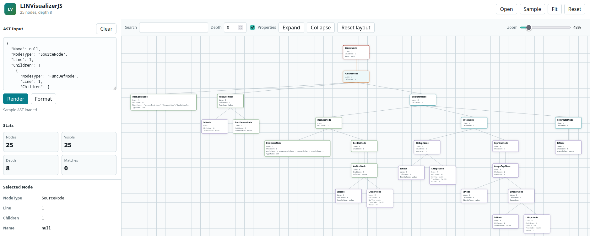

# LINVisualizerJS



Interactive browser visualizer for LINVAST AST JSON output.

## Usage

Run the visualizer:
```sh
./run
```

Open a LINVAST JSON file or paste the JSON into the input panel and render it.

## Development

Build the static app:

```sh
./build
```

Serve an existing build:

```sh
./run --no-build --port 5174
```

The project has no runtime package dependencies. `./build` validates JavaScript syntax, validates the sample AST JSON, and writes `dist/`.

## Features

- LINVAST JSON file loading and pasted JSON input.
- SVG tree rendering with pan, zoom, fit, reset, and node selection.
- Selected-node branch highlighting, draggable node positions, and layout reset.
- Node property toggling, max-depth cutoffs, branch collapse/expand, and search highlighting.
- Node counts, visible counts, tree depth, match counts, and selected-node details.

## LINVAST CLI dependency

The web server invokes a CLI executable; it does not reference LINVAST NuGet
packages. CLI builds use pinned **3.0.0** packages by default, even when a
neighboring LINVAST checkout exists. Opt into local source when building the CLI
with `-p:UseLocalLinvast=true`.

For production, publish the CLI against exactly 3.0.0, even if local source exists
(run from the CLI repository):

```sh
dotnet publish CLI/CLI.csproj -c Release -p:UseLocalLinvast=false -o ./publish-output
```

Deploy the complete publish output and point the server at its executable:

```sh
LINVAST_PATH=/absolute/path/to/publish-output/CLI ./run
```

Executable discovery remains: `linvast` on PATH, then `LINVAST_PATH`, then
`../CLI/CLI/bin/Debug/net10.0/CLI`. A PATH installation takes precedence over
`LINVAST_PATH`; ensure it is the intended production build or remove it from the
server's PATH. On Windows, use the published `CLI.exe` executable.
